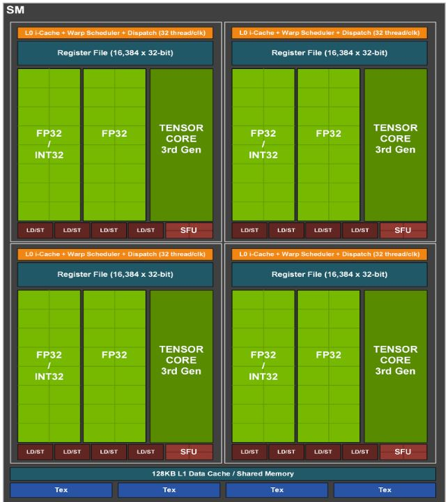
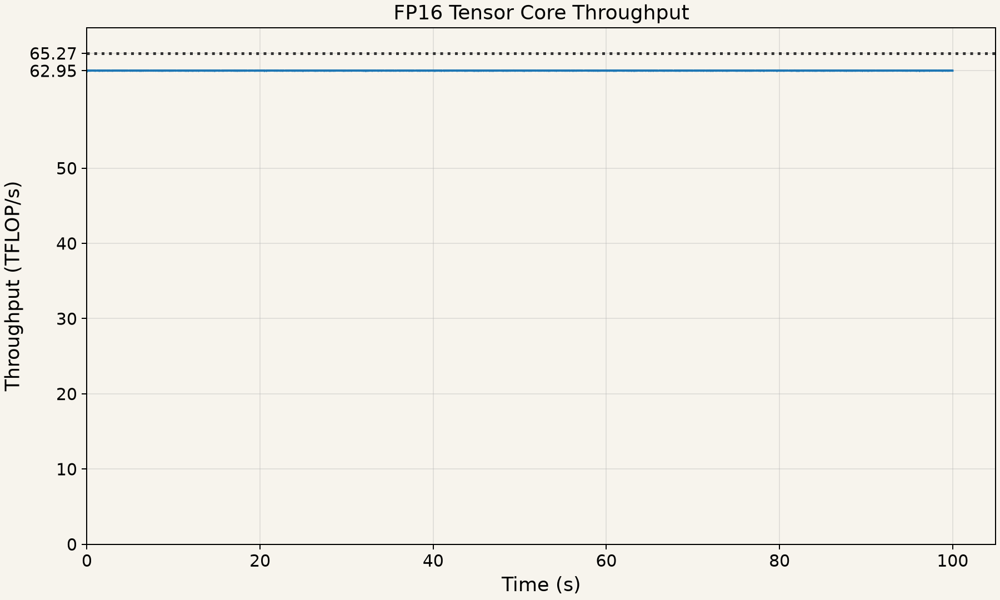

The A10 has 72 SMs ^[Can be obtained using `props = torch.cuda.get_device_properties(0); print(props.multi_processor_count)`]. It has a boost clock frequency of 1.695 GHz ^[Using `nvidia-smi -i 0 --query-gpu=clocks.max.sm`]. The A10 is based on the GA102 [architecture](https://www.nvidia.com/content/PDF/nvidia-ampere-ga-102-gpu-architecture-whitepaper-v2.1.pdf). The following figure shows its SM design:

::: {.intro-figure}
{width=60%}
:::

We observe that the SM has four sub-cores, with each containing 32 FP32 FMA ALUs (also called lanes in the context of SIMD hardware) ^[Note that 16 lanes in each sub-core can be used for either INT32 or FP32 operations]. So per SM, we have $32 \times 4 = 128$ FP32 arithmetic lanes. Each of these FMA ALUs can complete one FMA operation, counted as 2 FLOPs, on every clock cycle. ^[Note that we are not assuming that the latency of one FMA operation is one clock cycle. The ALUs are pipelined with enough independent FMA operations in flight for them to have throughput of 1 FMA per clock cycle.] We can now derive the advertised FP32 CUDA core throughput:

$72 \text{ (SMs)} \times 128 \text{ (FP32 lanes per SM)} \times 2 \text{ (FLOPs)} \times 1.695 \times 10^9 \approx 31.2 \text{ TFLOP/s}$

In fact, we can extend our analysis to Tensor Cores. The figure above shows that every sub-core has one Tensor Core. The GA102 whitepaper states in Table 6 that each Tensor Core can do 128 FP16 FMAs per clock cycle. ^[Tensor Cores actually perform MMA. Using the CUDA WMMA API, a warp can issue MMA on $16 \times 16$ sub-matrices, accumulating into a $16 \times 16$ matrix. That is $16^3 = 4096$ FMAs for that operation assuming dense matrices.] The advertised dense FP16 Tensor Core throughput is therefore:

$72 \times 4 \text{ (Tensor Cores)} \times 128 \text{ (FP16 FMAs per cycle)} \times 2 \times 1.695 \times 10^9 \approx 125 \text{ TFLOP/s}$

In the above analysis, we assumed the compute clock to be operating at the maximum frequency (boost frequency) of 1.695 GHz. However, the clock frequency can often be less than this depending on the GPU's power consumption and temperature. So, if the clock frequency is $f$ GHz, our theoretical peak FP16 Tensor Core throughput becomes $125 \times f / 1.695 \text{ TFLOP/s}$.

The above expression gives us the compute ceiling at this clock frequency for determining how efficiently our kernel is using compute. A kernel may fall short of this *theoretical* ceiling because of limited parallelism, tile or wave quantization effects, and other bottlenecks. Let's run a small benchmark to measure achieved throughput. 

After a 10 second warmup, we repeatedly multiply two $8192 \times 8192$ matrices for 100 seconds using cuBLAS, with FP16 inputs and output and FP32 accumulation. We know that multiplying 2 matrices of size $N \times N$ requires $2N^3$ FLOPs. We time each matrix multiplication using CUDA events (say, $t$ seconds) and calculate its achieved throughput $2N^3/t$. Here is the plot of our achieved throughput over this duration:

::: {.intro-figure}
{width=85%}
:::

The observed clock frequency was 885 MHz ^[A background process sampled the SM clock using `nvidia-smi` approximately once per second. We tried locking the clock at boost frequency 1.695 GHz; however, that did not force the GPU to run at that frequency. We have not investigated the reason why the GPU did not run at boost frequency.]. At this frequency, the theoretical FP16 Tensor Core throughput is $125 \times 0.885/1.695 = 65.27 \text{ TFLOP/s}$; this is what the dotted line in the figure represents. The cuBLAS routine achieves 96.44% of this theoretical peak. ^[We will discuss some of the kernel optimizations that enable this performance in a later chapter.] All 100 clock samples reported 885 MHz and, as the plot shows, the achieved throughput is sustained throughout.

